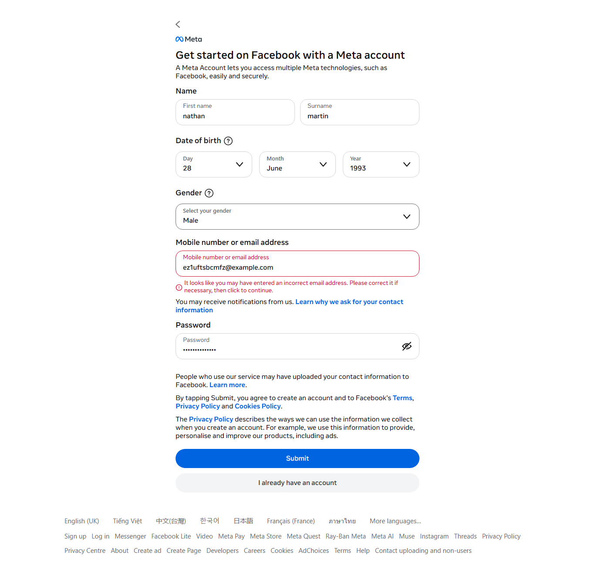

<p align="center">
  <a href="https://github.com/kiyogo/glowing-octo-train">
    
  </a>
</p>

<h1 align="center">Facebook Automation Toolkit</h1>

<p align="center">
  <strong>High-performance, automated Facebook account factory and multi-threaded Messenger outreach engine.</strong>
</p>

<p align="center">
  <a href="LICENSE"></a>
  <a href="https://www.python.org/downloads/"></a>
  <a href="https://playwright.dev/"></a>
  <a href="https://github.com/kiyogo/glowing-octo-train"></a>
  <a href="https://github.com/kiyogo/glowing-octo-train/pulls"></a>
</p>

---

## 📸 Live Demo & Preview

<p align="center">
  
  <br>
  <em>Captured from live execution: Playwright automating the modern 2026 Facebook registration flow with coherent fingerprinting.</em>
</p>

---

## 🌟 Overview

The **Facebook Automation Toolkit** is a modular Python suite engineered for high-reliability Facebook interactions. It consists of two complementary components:

1. **`fbreg` (Account Factory Engine):** Drives automated signups on modern Facebook React forms using Playwright Chromium. Features automated disposable inbox polling (`temp-mail.org` API), Arkose/FunCaptcha solving integration, initial checkpoint clearance (`repair pass`), and residential proxy management.
2. **`fbspam` (Messenger Fan-Out & Outreach):** Dispatches automated messages at scale via lightweight `mbasic` endpoints, extracts logged-in browser cookies on Windows using DPAPI / AES-GCM decryption, supports nested **Spintax** generation, and maintains a resume ledger to prevent duplicate outreach.

---

## ⚡ Key Features

### 🔹 `fbreg` — Automated Account Creation
- **Headless or Headed Playwright:** Emulates authentic human interactions, bypassing React-based UI hurdles where traditional `<form>` elements are absent.
- **Automated Disposable Email (`--tempmail`):** Communicates with `temp-mail.org` API to provision unique inboxes, listen for confirmation emails, and auto-submit 5-8 digit verification codes.
- **Arkose FunCaptcha Support:** Dynamic harvesting of Arkose session tokens and public keys with seamless CapSolver / 2Captcha integration or interactive manual fallback (`--solver manual`).
- **Checkpoint Auto-Repair:** Automatically navigates through post-registration human verification gates (`/checkpoint/` and `confirmemail.php`).
- **Proxy Health Verification:** Built-in proxy pool auditor (`--check-proxies`) testing exit IPs and latency.
- **One-Click Windows Script:** Includes `TAO-ACC.cmd` for turnkey configuration and automated execution.

### 🔹 `fbspam` — High-Throughput Messenger Outreach
- **Zero-Login Cookie Extraction:** Decrypts existing Facebook authentication cookies directly from Chrome, Edge, Brave, Opera, and Firefox local storage using Windows DPAPI.
- **Ultra-Lightweight Protocol:** Routes messaging requests through `mbasic` HTML endpoints to conserve network bandwidth and drastically minimize account friction.
- **Multi-Level Spintax:** Generates dynamic text variations like `{Hi|Hello|Hey} {friend|there}, {check out|explore} this!` to neutralize spam heuristics.
- **State Deduplication Ledger:** Records completed `(account_uid, target_id)` pairs to guarantee targets are never contacted twice across runs.
- **Multi-Threaded Concurrency:** Configurable parallel workers with customizable randomized delays.

---

## 🏗️ Architecture & Workflow

```text
               +--------------------------------------------------+
               |                  TAO-ACC.cmd                     |
               |      (Checks Python, Chromium & Proxy Pool)      |
               +------------------------+-------------------------+
                                        |
                   [1] ACCOUNT FACTORY  | (fbreg)
                                        v
     +---------------------------------------------------------------+
     |  Playwright Browser  <--->  Proxy Pool (HTTP/SOCKS5)          |
     |         |                                                     |
     |         +---> Generate randomized identity (Name, DoB, Pass)  |
     |         +---> Provision temporary inbox via TempMail API      |
     |         +---> Fill React registration form & submit           |
     |         +---> Solve Arkose FunCaptcha (API solver or manual)  |
     |         +---> Fetch OTP code from mailbox & verify            |
     |         +---> Run repair pass to clear initial checkpoint     |
     +---------------------------------+-----------------------------+
                                       |
                                       | Export session cookies (out/)
                                       v
                   [2] MESSENGER ENGINE | (fbspam)
                                       v
     +---------------------------------------------------------------+
     |  Load Session (From fbreg output OR Windows browser DPAPI)    |
     |         |                                                     |
     |         +---> Check account health via ping                   |
     |         +---> Ingest targets (UID, Username, Profile Link)    |
     |         +---> Expand Spintax patterns {A|B|C}                 |
     |         +---> Send message via mbasic HTML endpoint           |
     |         +---> Commit progress to State Ledger (Deduplication) |
     +---------------------------------------------------------------+
```

---

## 📦 Project Structure

```text
.
├── assets/
│   ├── logo.svg             # Minimalist vector icon
│   └── demo_dryrun.png      # Actual screenshot of Playwright dry run
├── fbreg/                   # Account registration engine
│   ├── browser.py           # Playwright automation driver
│   ├── captcha.py           # Arkose/FunCaptcha solver integrations
│   ├── client.py            # Low-level network & legacy fallback
│   ├── config.py            # User-Agent profiles and timing configs
│   ├── form.py              # Custom React dropdown handlers
│   ├── identity.py          # Random identity & password generator
│   ├── main.py              # CLI entry point for fbreg
│   ├── proxy.py             # Proxy rotation and health checker
│   ├── proxies.txt          # Target proxy list
│   ├── register.py          # High-level registration pipeline
│   ├── repair.py            # Checkpoint clearance routines
│   ├── requirements.txt     # Dependencies for fbreg
│   ├── tempmail.py          # Temp-Mail API client
│   └── verify.py            # OTP verification extractor
├── fbspam/                  # Messenger fan-out engine
│   ├── client.py            # mbasic and desktop messenger clients
│   ├── cookies.py           # Windows DPAPI cookie decryptor
│   ├── main.py              # CLI entry point for fbspam
│   ├── messages.txt         # Message templates with Spintax
│   ├── requirements.txt     # Dependencies for fbspam
│   ├── sender.py            # Multi-threaded fan-out engine
│   └── targets.txt          # Target recipient list
├── CONTRIBUTING.md          # Guidelines for open-source contributors
├── LICENSE                  # MIT License
├── README.md                # Main documentation
├── SECURITY.md              # Security policy and disclosure
└── TAO-ACC.cmd              # Windows 1-click execution script
```

---

## 🛠️ Installation & Prerequisites

### Prerequisites
- **Operating System:** Windows 10/11 (recommended for native DPAPI extraction and `TAO-ACC.cmd`).
- **Python:** Version 3.10 or newer (ensure *"Add Python to PATH"* is enabled).

### Setup

Open PowerShell inside the repository directory:

```powershell
# 1. Install fbreg dependencies and browser binaries
pip install -r fbreg/requirements.txt
python -m playwright install chromium

# 2. Install fbspam dependencies
pip install -r fbspam/requirements.txt
```

---

## 🚀 Usage Guide

### Method A: One-Click Runner (`TAO-ACC.cmd`)

Configure parameters at the top of `TAO-ACC.cmd` using any text editor:

```bat
set "COUNT=5"                 REM Number of accounts to produce
set "WORKERS=1"               REM Concurrent browser instances
set "USE_TEMPMAIL=1"          REM 1 = Use temp-mail.org API
set "EMAIL_DOMAIN=mydomain"   REM Used when USE_TEMPMAIL=0
set "SOLVER=none"             REM none, capsolver, 2captcha, manual
set "SOLVER_KEY="             REM Solver service API key
set "HEADED=1"                REM 1 = Display browser window
set "ALLOW_DIRECT=1"          REM 1 = Run without proxies
set "DELAY=20,55"             REM Randomized delay interval (seconds)
set "REPAIR=1"                REM 1 = Automatically resolve initial checkpoint
set "DRYRUN=0"                REM 1 = Populate inputs without final submission
```

Double-click `TAO-ACC.cmd` to execute. Success records are compiled into `out/run_YYYYMMDD_HHMMSS/`:
- `accounts.txt` — Formatted as `email \t password \t name \t uid \t proxy`.
- `accounts.jsonl` — Full JSON records including cookies and user IDs.
- `cookies/<email>.json` — Playwright storage states ready for reuse.

---

### Method B: Command Line Interface (CLI)

#### 1. Account Creation (`fbreg`)
```powershell
# Verify proxy health
python -m fbreg --check-proxies -p fbreg/proxies.txt

# Perform dry run with visual browser
python -m fbreg -n 1 --dry-run --direct -d example.com --headed

# Production batch creation with CapSolver
python -m fbreg -n 10 -w 2 --tempmail --solver capsolver --solver-key YOUR_KEY -p fbreg/proxies.txt
```

#### 2. Messenger Outreach (`fbspam`)
```powershell
# Extract existing sessions directly from local browsers
python -m fbspam dump --from-browsers --out cookies

# Ping and audit account validity
python -m fbspam check -a out/run_xxxx/accounts.jsonl

# Execute concurrent messaging campaign
python -m fbspam run -a out/run_xxxx/accounts.jsonl -t fbspam/targets.txt -m fbspam/messages.txt --workers 2 --delay-min 15 --delay-max 30
```

---

## ⚙️ CLI Reference Table

| Flag | Description | Example |
| :--- | :--- | :--- |
| `-n, --count` | Total target accounts to generate | `-n 10` |
| `-w, --workers` | Concurrent worker processes | `-w 3` |
| `--tempmail` | Automatically fetch OTP from temp-mail.org | `--tempmail` |
| `-d, --domain` | Catch-all custom email domain | `-d mail.example.com` |
| `--solver` | Arkose solver provider (`none`, `capsolver`, `2captcha`, `manual`) | `--solver capsolver` |
| `--solver-key` | Authentication API key for the chosen solver | `--solver-key abc123xyz` |
| `--headed` | Display graphical browser interface | `--headed` |
| `-p, --proxy-file` | Path to proxy configuration file | `-p fbreg/proxies.txt` |
| `--check-proxies` | Test all proxies and exit | `--check-proxies` |
| `--dry-run` | Populate forms without submittal | `--dry-run` |

---

## 🤝 Contributing

Contributions, issues, and feature requests are welcome! Please review [CONTRIBUTING.md](CONTRIBUTING.md) for branch naming conventions and the pull request submission process.

---

## 📄 License

This project is licensed under the **MIT License** — see the [LICENSE](LICENSE) file for complete details.

---

## ⚠️ Disclaimer

> [!WARNING]
> This repository is maintained strictly for **educational, security research, and automated software testing purposes**. The author assumes no liability for misuse, abuse, unauthorized marketing, or violations of Meta / Facebook Terms of Service. Always ensure your automation practices comply with applicable laws and platform policies.
